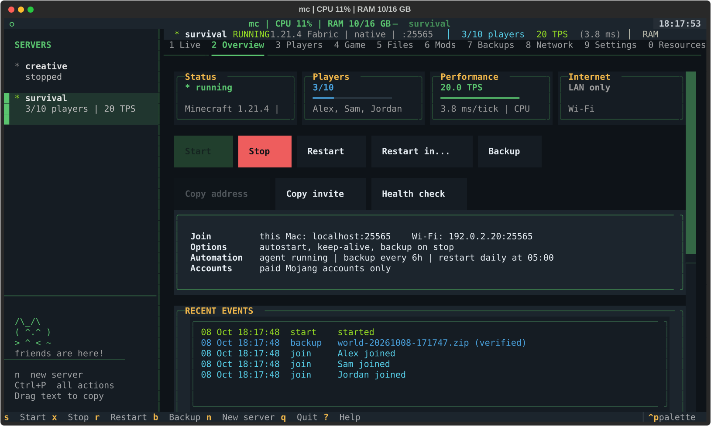
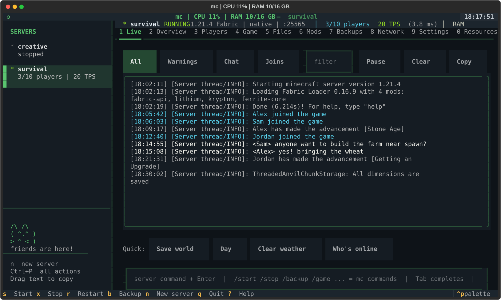
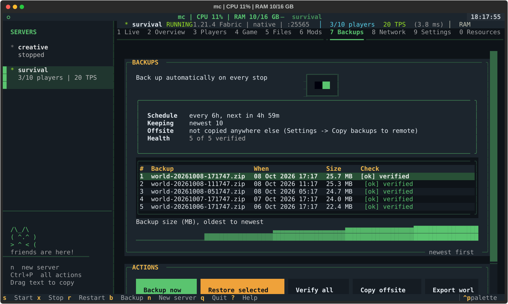

<!-- datasheet:banner -->
<p align="center">
  <picture>
    <source media="(prefers-color-scheme: dark)" srcset=".github/assets/banner-dark.svg">
    
  </picture>
</p>
<!-- /datasheet:banner -->

<div align="center">

# mc-server-manager

**Run Minecraft servers on your own computer from one command and a terminal dashboard.**

[](https://github.com/S-k404/mc-server-manager/actions/workflows/ci.yml)
[](LICENSE)




<sub>The dashboard (`mc`), showing a made-up demo server. More pictures are in <a href="docs/images">docs/images</a>.</sub>

</div>

`mc` creates, runs and looks after Minecraft servers on a machine you own: a laptop, a desktop or a small VPS.
It downloads and checks everything a server needs, keeps each server in its own `tmux` session, installs mods from Modrinth,
makes backups it can verify, restarts what crashes, and helps your friends get in. You use it from the command line, or from a
full-screen dashboard in the same terminal.

<!-- datasheet:figure -->
## At a glance

<p align="center">
  <picture>
    <source media="(prefers-color-scheme: dark)" srcset=".github/assets/diagram-dark.svg">
    
  </picture>
</p>

| Characteristic | Detail |
| --- | --- |
| **Interfaces** | `mc` Typer CLI and full-screen Textual TUI dashboard (`mc dashboard`) for local Paper, Fabric, Vanilla and Forge servers |
| **Safety** | Never deletes a world: automatic pre-upgrade and scheduled tar backups (`backups/`) with checksum verification |
| **Runtimes** | Native Java in detached `tmux` sessions (`mc-<name>`) or isolated Docker containers with RCON console attach |
| **Networking** | Three share modes (`hidden` loopback, `local` Wi-Fi, `internet` ProtonVPN port-forward + Simple Voice Chat UDP) |
| **Diagnostics** | Built-in `moddoctor`, multiplayer status-ping `speedtest`, and hop-by-hop VPN forwarder `trace` |
<!-- /datasheet:figure -->

## What it does

- **Servers.** Create a Fabric, Quilt, NeoForge, Forge, Paper or vanilla server on any Minecraft version in one command. The right
  Java runtime is downloaded for it. Start, stop and restart with in-game countdown warnings, clone, rename, and move to another
  Minecraft version with a safety net (`mc upgrade`). Run it natively or inside a Docker container, on the same folder.
- **Looked after.** A background agent (launchd on macOS, systemd on Linux) starts servers at login, restarts them after a crash,
  runs scheduled backups and daily restarts, and sends alerts to the desktop and optionally a Discord channel.
- **Mods.** Search and install from Modrinth with their dependencies, update, pin. `mc mods doctor` reads every jar's own
  metadata to find mods that are missing something, in conflict, duplicated or built for the wrong version, and fixes the safe cases.
  Datapacks, resource packs and `.mrpack` modpacks (import and export for friends' game clients) are covered too.
- **Players.** Operators, whitelist, bans, kicks, private messages and a profile for each player. Offline-mode servers can use a
  login mod, and player data is migrated when you switch modes. `mc game` has quick helpers: time, weather, teleport, give, border.
- **Backups.** World zips that are checked after they are written, with retention rules, automatic backups on stop or on a schedule,
  an optional copy to another machine, and a restore that keeps your current world.
- **Getting friends in.** On your Wi-Fi it is the machine's address. For the internet, `mc vpn` runs a ProtonVPN port forward in
  Docker (a paid Proton plan), so your own machine never joins the VPN. A "hidden" share mode keeps your home address out of
  invites. Or run on a VPS with `mc deploy`.
- **Diagnostics.** `mc doctor` checks lag, ports, mods, backups and the network. `mc speedtest` measures latency to the server and
  (on macOS) to each connected player. `mc support` prints one block for a bug report with passwords, keys and addresses stripped out.
- **A dashboard** with tabs for the live console, overview, players, game helpers, a file editor, mods, backups, network, settings
  and resources. It stays quiet when nothing is happening.

## Quick start

You need a Mac or a Linux machine, `git` and [tmux](https://github.com/tmux/tmux). Python 3.12 or newer and Java are fetched for
you if the machine does not have them.

```sh
git clone https://github.com/S-k404/mc-server-manager.git
cd mc-server-manager
./install.sh                    # a private Python environment, and `mc` on your PATH
mc create survival              # latest Minecraft, Fabric, 4 GB of RAM (`mc create` alone asks the questions instead)
mc start                        # starts it; downloads Java first if it is missing
mc                              # opens the dashboard
```

Options go on `mc create`: for example `mc create builds --loader paper --version 1.21.4 --ram 6`. List what is available with `mc versions`
and `mc loaders`.

Creating a server means you accept the [Minecraft EULA](https://aka.ms/MinecraftEULA); `mc create` records that for you, so read
it first.

Everyday commands (`mc <command> -h` shows every option, [docs/COMMANDS.md](docs/COMMANDS.md) lists them all):

```sh
mc status                       # state, players, mods and settings at a glance
mc console                      # the live server console
mc mods search sodium           # find mods that work on this server's version and loader
mc mods add lithium             # install one, plus what it needs
mc backup                       # a verified backup of the world now
mc info                         # the address your friends join
mc agent install                # keep servers running in the background from now on
mc doctor                       # health check
```

<details>
<summary>More screenshots</summary>





</details>

## Supported systems

| | |
|---|---|
| macOS | Developed and used day to day on Apple Silicon. A few things are macOS-only and say so (per-player latency in `mc speedtest`, Apple's `networkQuality`, the Bonjour name in `local` share mode) |
| Linux | The tests run on Ubuntu in CI, and a VPS is the usual place ([docs/REMOTE.md](docs/REMOTE.md)). Other distributions should work but are not tested |
| Windows | Not supported |

## How it works

```
mc-server-manager/
├── mc                 the launcher (what `install.sh` puts on your PATH)
├── mcctl/             the tool itself (Python: CLI + Textual dashboard)
├── servers/<name>/    one folder per server: world, mods, server.properties, instance.json
├── backups/<name>/    world zips, and anything mc moved aside (it never deletes a world or a server)
├── runtime/           the Java runtimes mc downloaded
└── tunnel/            the VPN key and proxy password (owner-only files)
```

Each server runs in a tmux session named `mc-<name>`; commands go in over RCON. A server's own settings live in its
`instance.json` (version, loader, port, RAM, schedules); machine-wide settings live in `.mc-settings.json`. Your worlds, backups,
keys and logs are git-ignored: the repository only ever holds the tool.

`mc` also works over SSH on a VPS: `mc remote add`, `mc -r <remote> status`, `mc deploy <remote>`. See [docs/REMOTE.md](docs/REMOTE.md).

## Safety

- It never deletes a world or a server: `mc delete` and restores move things into `backups/`.
- Server jars, mods, datapacks and modpack files are checked against the checksum their source publishes. (The Java runtime
  download is the one exception today; see [SECURITY.md](SECURITY.md).)
- Anything typed by a person that reaches a server console is validated first.
- Secrets (the VPN key, the proxy password, a Discord webhook) are stored owner-only, kept off command lines, and stripped from
  `mc support` output.
- Every config write is atomic, every server operation takes a lock, and big operations check the disk first.
- It reads other apps' settings (for example whether ProtonVPN allows LAN traffic) and tells you what to change; it never
  changes another app's settings, routes or firewall.

See [SECURITY.md](SECURITY.md) to report a problem.

## Documentation

| | |
|---|---|
| [docs/COMMANDS.md](docs/COMMANDS.md) | Every command, generated from the CLI |
| [docs/DOCKER.md](docs/DOCKER.md) | The ProtonVPN port-forward stack, the Docker runtime, share modes, the sign-in proxy |
| [docs/REMOTE.md](docs/REMOTE.md) | Running `mc` on a VPS |
| [CHANGELOG.md](CHANGELOG.md) | What changed in each version |

## Contributing

Bug reports, ideas and pull requests are welcome. Start with [CONTRIBUTING.md](CONTRIBUTING.md); it explains how to set up, run the
tests (they are offline) and what the conventions are. Please read the [Code of Conduct](CODE_OF_CONDUCT.md).

Much of this code was written with the help of an AI coding assistant (Claude Code), and every change goes through the same test
suite.

## Disclaimer

This is an independent project. It is not affiliated with or endorsed by Mojang Studios, Microsoft, Modrinth, Proton or Docker.
Minecraft is a trademark of Mojang Synergies AB.

## License

[MIT](LICENSE)

<!-- datasheet:footer -->
---

<p align="center">
  <a href="https://github.com/S-k404/pi5-homelab-rack">&larr; U18 pi5-homelab-rack</a> &middot;
  <a href="https://github.com/S-k404/S-k404">SK-404 index</a> &middot;
  <a href="https://github.com/S-k404/openfoam-mac-suite">U21 openfoam-mac-suite &rarr;</a>
</p>
<!-- /datasheet:footer -->
